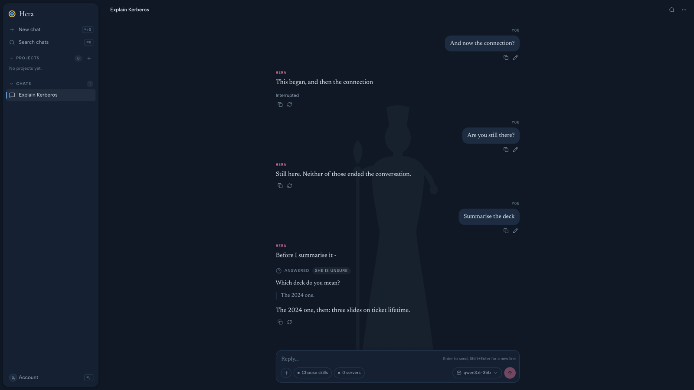
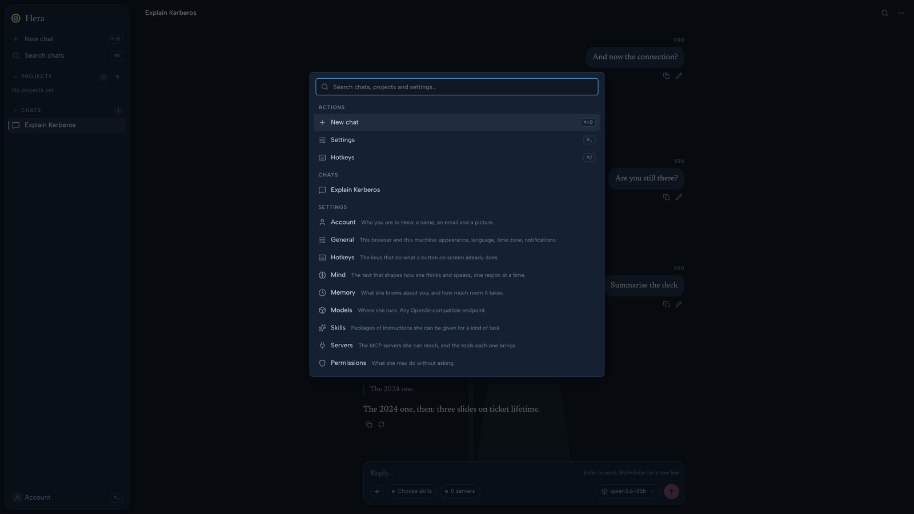
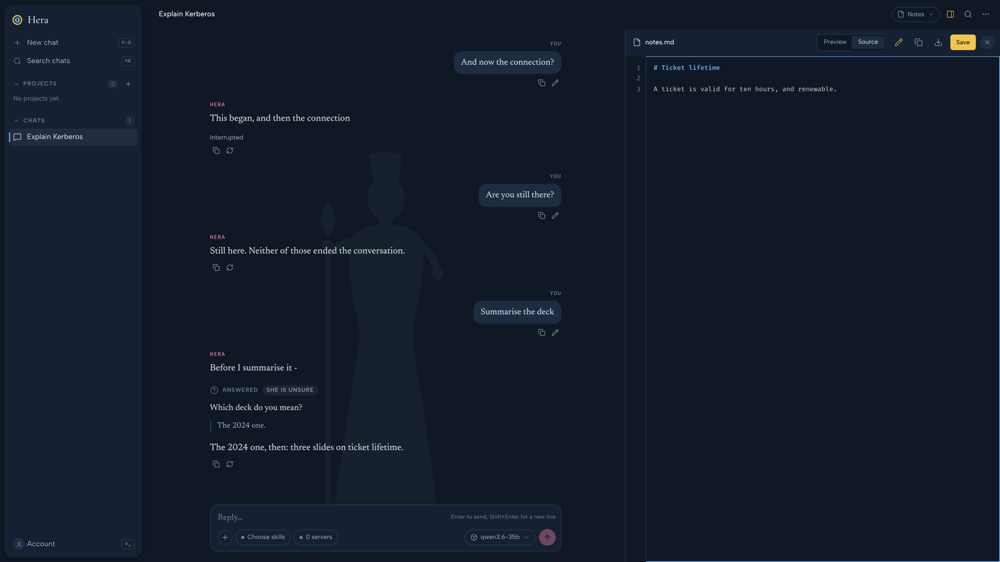
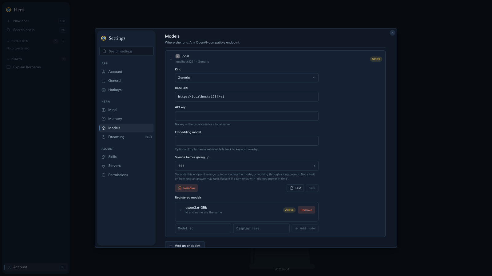

# Hera

[](https://github.com/VoidEUW/hera/actions/workflows/ci.yml)
[](https://github.com/VoidEUW/hera/releases)
[](LICENSE)

A self-hosted agentic chat space. One server on your own machine, reachable from your desk and
from your phone, talking to a **local** model over an OpenAI-compatible endpoint.

Hera is not a thin chat window. She keeps a **git-versioned mind** you can read and edit,
**remembers** what matters about you in files you can take elsewhere, **publishes** what she makes
as real artifacts, and **asks** rather than guessing when being wrong would cost you real work. Her
tools come from **MCP servers** and her know-how from **`SKILL.md` skills**, so both are portable to
and from the rest of the ecosystem.



## What makes it different

| | |
|---|---|
| **She asks instead of guessing** | `hera__ask` stops the turn, puts a question on screen and waits — and your reply becomes that call's result, so she carries on in the same answer rather than starting a new one. Three kinds, about the question: *unsure*, *blocked*, *choice*. |
| **A mind you can read** | Identity, role, character, tone, safety and workflow each live as a Markdown file in a real git repository under `~/.hera/mind/`. Editing one is a commit. Nothing changes without your approval. |
| **Memory you can take with you** | One markdown file per memory in `~/.hera/memories/`, and **every one that is switched on is in her prompt, whole** — no retrieval, so a memory that was stored cannot silently fail to arrive. The cost is space, so the space is on screen: a bar, and a switch that keeps a memory without paying for it. **Export `MEMORY.md`** and take the lot somewhere else. |
| **Artifacts you can edit** | A page, a chart, a diagram, a document, published as a *file* rather than left in a code fence — with a panel beside the conversation, a download, and a pen of your own: fix a typo and save it, no round trip. She changes one line with `edit` instead of re-emitting 40 KB. |
| **A scratchpad per conversation** | Somewhere to leave herself a plan between turns. Hers, unread, and thrown away with the chat. |
| **MCP-native tools** | `~/.hera/mcp.json` uses the same shape as Claude Desktop. Point her at a server and its tools are hers. |
| **Deterministic skills** | Skills are `SKILL.md` packages, but *Hera does not have to notice them*: a server-side router pins, resolves `/slash` invocations and retrieves by relevance before the model ever sees the turn. |
| **Keyboard first** | `⌘K` finds a chat, a project or a screen; `⌘F` finds a word in the conversation; every shortcut mirrors a button on screen and is listed under Settings → Hotkeys. |
| **Dreaming** *(v0.3)* | Hera re-reads her own conversations and proposes changes to her mind and memory. Every proposal is a card you accept, reject or revert. Listed on the settings screen and disabled until then, because a feature you can see coming is a promise and one you cannot is a surprise. |

## Status

**v0.2.2 is the latest release** — see the [releases](https://github.com/VoidEUW/hera/releases).
v0.2.0 made her *accumulate* (projects, a scratchpad, artifacts, memory); v0.2.1 is the polish
pass: the interface rebuilt on one theme, the command palette and hotkeys, editable artifacts,
diagrams, reading a skill's bundled files. v0.2.2 is v0.2.1 with its dependencies' security fixes.
**Dreaming and experience training are v0.3.** Each version is planned in
[docs/versions/](docs/versions/) before the work starts, and [docs/status.md](docs/status.md) says
where things stand right now.

## A look



*`⌘K` — one place to find a chat, a project or a screen, with the key for each action beside it.*



*The side view — what she published, with a pen of your own.*



*Settings — models, skills, servers, permissions, memory and her mind.*

## Requirements

- Python 3.12+ and [uv](https://docs.astral.sh/uv/)
- Node 24 (for the web app; not needed with Docker)
- A local OpenAI-compatible endpoint — LM Studio, vLLM or llama.cpp. **DeepSeek, GLM, Qwen, Kimi
  and Gemma** are the preferred targets, and Anthropic or OpenAI models reached the same way work
  too; anything with working native tool calling should behave. A model whose tool-calling isn't
  reliable can be told not to use tools at all in Settings → Models, rather than attempting a
  call it cannot make.

## Quick start

```bash
git clone https://github.com/VoidEUW/hera.git
cd hera
uv sync --all-packages
uv run hera serve                 # http://localhost:8756
```

Or with Docker — the image is built for amd64 and arm64:

```bash
docker run -p 8756:8756 -v hera_data:/data ghcr.io/voideuw/hera:latest
# or, from a checkout: docker compose up
```

`:latest` is always the newest *release*, `:rc` follows the newest release candidate, and an exact
version (`:0.2.2`) is always there. A container reaches a model on the host through
`host.docker.internal` — see the comments in [docker-compose.yml](docker-compose.yml).

It binds to `127.0.0.1` and there is no login: Hera is one person's server on one person's
machine, and every route resolves an owner through a single seam so that adding one later is a
change in one function rather than in every query. **Do not put this on a public interface as it
stands.**

Everything Hera owns lives under `~/.hera/` (`HERA_HOME` overrides it):

| | |
|---|---|
| `hera.sqlite3` | chats, messages, projects, profiles, and what each answer cost in tokens |
| `mind/` | a real git repository, one file per mind region |
| `memories/<key>.md` | what she knows about you — one file each, and the filename is the key |
| `skills/<name>/SKILL.md` | skill packages |
| `chats/<id>/` | one conversation's `scratch/` and `artifacts/` |
| `mcp.json` · `config.toml` | MCP servers, and the model endpoints the interface writes |
| `permissions.json` | the permission rules you made, or answered "always" on a card |

## Architecture

A [uv workspace](https://docs.astral.sh/uv/concepts/projects/workspaces/) of small libraries, a
FastAPI application and a SvelteKit interface. **Imports point downwards**: every package has one
job and imports only the ones below it, and `tests/test_layering.py` checks it rather than trusting
it.

```
apps/core   FastAPI (/api/v1 JSON + SSE) and the SvelteKit app it serves
   │
   ├─ hera_chats      projects, chats, the persisted event stream, the turn orchestrator
   ├─ hera_profiles   the mind: regions as files in a git repository, and the prompt builder
   ├─ hera_skillsets  SKILL.md packages and the router that picks them
   ├─ hera_memories   one markdown file per memory, every enabled one in the prompt
   ├─ hera_tools      the MCP client she has          hera_mcp   the MCP server she is
   ├─ hera_providers  one event union for what a model can emit
   ├─ hera_permissions · hera_home
   └─ hera_storage · hera_prompts     domain-free by contract: liftable into another project
```

A turn is: route skills in code, build the prompt from the mind, stream from the model, check
permissions and run tools as calls arrive, and persist the events. The server's render is
authoritative — the browser draws optimistically while streaming and replaces it with the stored
events at the end, so a reload can never disagree with what you watched. The packages, the turn
and the rules that hold everywhere are in [ARCHITECTURE.md](ARCHITECTURE.md); the reasons are in
[docs/adr/](docs/adr/).

## Theming

A theme is **imported data, not CSS that is written** ([ADR 21](docs/adr/0021-a-theme-is-imported-data.md)).
Design a theme in the Hera Theme Builder, export it as one Markdown file, and import it:

```bash
cd apps/core/web
npm run theme:import docs/themes/hera-theme-heaven.md
```

That generates tokens (colour in both modes, type faces, shape, a duration and curve for every
moving part) under `src/lib/themes/`. A component reads tokens only — no literal colour, font,
radius or duration — and every control is a primitive in `src/lib/components/ui/`, ported from the
builder's own markup, so a theme changes how Hera looks and never how it is built. Tests fail on a
literal, on a control opened outside the primitives, and on a token a registered theme does not
define. Run the app and open `/design` to see every primitive in every state. **Heaven** is the
shipped theme; what Hera adds to it is written in the export's *Hera amendments* section.

## Translations

Every string the interface shows goes through one typed catalogue, `t`, in
`apps/core/web/src/lib/i18n.ts`, rather than being written into a component — so a second language
is a second catalogue of the same shape and not a hunt through the components. The interface is
English today, and everything written in this repository — code, comments, commits, prompts,
stored content — is English.

## Development

```bash
uv run ruff check . && uv run ruff format --check .
uv run mypy
uv run coverage run -m pytest && uv run coverage report
cd apps/core/web && npm run check && npm run lint && npm run test:unit
uv run pytest -m e2e              # Playwright against a scripted model, no endpoint needed
```

Everything is one workspace: a single `uv sync` and every library is editable in place. See
[CONTRIBUTING.md](CONTRIBUTING.md).

## How the project runs

- **Issues and pull requests** use templates; work happens on a short-lived branch off `main`, is
  squash-merged, and `main` is always releasable. Titles are
  [Conventional Commits](https://www.conventionalcommits.org/) — they are the release notes.
- **Decisions** that change the shape of the system get an [ADR](docs/adr/), numbered and never
  edited after the fact.
- **CI** runs lint and formatting, `mypy --strict`, the tests with a coverage gate on two Python
  versions, the web checks, the browser tests, and CodeQL. A **capture** job drives the real
  interface and films it, so a pull request that changes the UI can be reviewed by looking.
- **Releases** are tags. A tag publishes a GitHub release whose notes are written from the commits;
  `v0.2.1-rc4` is a pre-release and `v0.2.1` a release ([how](CONTRIBUTING.md#cutting-an-application-release)).
  There is no changelog file — the [releases page](https://github.com/VoidEUW/hera/releases) is it.

## Layout

```
packages/          the libraries, each with one job and no upward imports
apps/core          hera-core — FastAPI and, under web/, the SvelteKit interface it serves:
                   desktop-shaped, installable as a PWA
docs/adr/          why the structure looks like this
docs/versions/     what each version is for, written before the work rather than after
docs/status.md     where the rebuild stands right now
docs/frontend.md   the design language, the components, the keyboard
```

## Licence

MIT.
